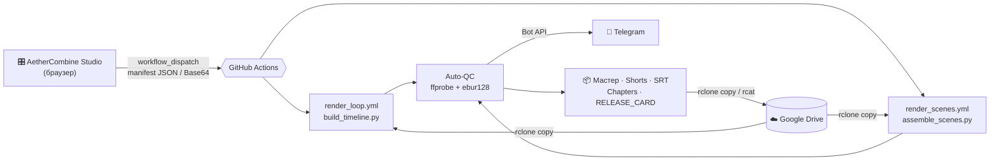

<div align="center">

# ⚙️ aetherflow-render

**Облачный FFmpeg-раннер: собирает 4K-мастера и многочасовые ambience-лупы по манифесту из AetherCombine Studio**

[](https://github.com/ZermeXX/aetherflow-render/actions/workflows/ci.yml)
[](#)
[](#)
[](#)
[](#)
[](#)

[**🎛️ Пульт управления (Studio)**](https://github.com/ZermeXX/aethercombine-studio) · [**🌐 Live Studio**](https://zermexx.github.io/aethercombine-studio/)

</div>

---

## 🔥 Что это

Этот репозиторий — **исполняемая часть** продакшн-пайплайна. Браузерная студия собирает JSON-манифест, отправляет его через `workflow_dispatch` — и всё тяжёлое происходит здесь, на раннере GitHub Actions:

- 🌙 **Многочасовой луп** — 3–10 часов 4K из коротких исходников: бесшовные петли, кроссфейды актов, асимметричные врезки, loudnorm, главы.
- 🏛️ **Повествовательный монтаж** — N сцен с дикторской озвучкой, анимированными lower-thirds, мультиязычными SRT и Auto-QC.
- 📱 **Shorts-фабрика** — вертикальные 9:16 тизеры с хук-титрами по таймкодам врезок.
- 📦 **Метаданные релиза** — `RELEASE_CARD.md`, `output_chapters.txt`, `qc_report.json`.

> Ни один многогигабайтный мастер не проходит через компьютер пользователя: исходники и результаты живут на Google Drive, рендер — в облаке.

---

## 🏗️ Архитектура



---

## 📂 Файлы

| Файл | Назначение |
|---|---|
| **`build_timeline.py`** | Основной движок лупа: loop-baker, мосты актов, врезки `inserts[]`, главы, Auto-QC, stream-upload |
| **`assemble_scenes.py`** | Повествовательный монтаж: N сцен, диктор + эмбиент, lower-thirds, `actual_timings.json` |
| **`lower_third_overlay.py`** | Анимированные документальные плашки (Pillow → PNG-секвенция → `overlay`) |
| **`shorts_factory.py`** | Вертикальные Shorts 1080×1920 с панорамой, хуками и loudnorm |
| **`assemble_pipeline.py`** | Однопроходный вариант лупа (piece-модель + 2 с чёрного в финале), без врезок |
| **`tests/`** | Регрессия тайм-математики + дымовой прогон реальных FFmpeg-графов |

### Workflows

| Workflow | Триггер | Что делает |
|---|---|---|
| `render_loop.yml` | `workflow_dispatch` | Preflight → луп → Shorts → метаданные → Drive → Telegram |
| `render_scenes.yml` | `workflow_dispatch` | Preflight → сцены → SRT/главы → Shorts → 720p-превью → Drive |
| `ci.yml` | push / PR | `compileall` + YAML-lint + unit-тесты + FFmpeg-графы на `testsrc` |
| `ai-fix.yml` | вручную | Gemini-агент читает `tasks/*.md`, правит код, открывает PR |

---

## 🧮 Математика лупа (почему это не «просто concat»)

**1. Loop-baker.** Короткий исходник `S` секунд превращается в бесшовную петлю длины `S − D`, где `D` — шов:

```
xfade(src, src, offset = S − D, duration = D)  →  trim[D : S]
acrossfade(head, tail, d = D)                  →  atrim[D : S]
```

Конец петли совпадает с её началом — дальше `-stream_loop` без единого видимого шва.

**2. Мосты актов.** Тело акта отдаёт по `C` секунд на вход и выход, стык собирается отдельным `xfade duration=C offset=0` — ровно `C`, не `1.5C`.

| Акт | `slot_duration_sec` | Тело | Мост → |
|---:|---:|---:|---:|
| 1 | 1800 | 1710 | 90 |
| 2 | 1890 | 1710 | 90 |
| 3 | 2490 | 2310 | 90 |
| 4 | 1290 | 1110 | 90 |
| 5 | 2490 | 2310 | 90 |
| 6 | 1290 | 1200 | — |
| **Σ** | **11250** | **10350** | **450** |

**Итог: 10350 + 450 = 10800 с = `3:00:00`.** Главы встают на `00:00 · 00:30 · 01:00 · 01:40 · 02:00 · 02:40`.
Все куски кодируются с идентичными параметрами (`-video_track_timescale 24000`, `yuv420p`, единый fps) → финальная склейка идёт через `concat -c copy`, без перекодирования.

<details>
<summary><b>🔊 Звук и диск</b></summary>

- **Loudnorm:** измерительный проход (`print_format=json`) → второй проход с `measured_*` и `linear=true`. Цель по умолчанию `-16 LUFS / -3 dBTP / LRA 11` для ambience, `-14 / -1` для документального.
- **Disk-guard:** локальный режим требует ≈ 2× вес мастера (промежуточный + финальный файл). Если прогноз не влезает — включается `--stream`: финал мультиплексируется в `pipe:1` → `rclone rcat`, и весь файл никогда не лежит на диске раннера.
- **Оценка веса** учитывает тип контента: статичный ambience ≈ 3 Мбит/с, динамичное видео ≈ 18 Мбит/с.

</details>

---

## 📥 Манифест

Минимальный пример для лупа:

```json
{
  "project_name": "Histoviva Ambient 4K",
  "content_profile": "ambience",
  "export_settings": {
    "video_codec": "libx264", "preset": "veryfast", "crf": 20,
    "width": 3840, "height": 2160, "fps": 24, "audio_bitrate": "320k",
    "output_filename": "AMBIENT_4K.mp4"
  },
  "cloud_export": { "target_folder_id": "1A2b3C..." },
  "timeline_slots": [
    {
      "slot_id": "SLOT_01",
      "slot_duration_sec": 1800,
      "title_en": "Act I: The Frozen Perimeter",
      "base_content": { "file_name": "blizzard_loop.mp4", "loop_crossfade_sec": 1.0 },
      "slot_transition_out": { "type": "crossfade", "duration_sec": 90 },
      "inserts": [
        {
          "insert_id": "E1",
          "file_name": "ember_crackle.mp4",
          "trigger_at_sec": 900,
          "duration_sec": 12,
          "transition_in":  { "type": "dissolve", "duration_sec": 1.5 },
          "transition_out": { "type": "dissolve", "duration_sec": 1.5 }
        }
      ]
    }
  ]
}
```

> ⚠️ Каноническое поле длительности — **`slot_duration_sec`**. Пустой `file_name` блокирует запуск на preflight: граф никогда не получает `-i ""`.

---

## 📤 Артефакты

| Файл | Содержание |
|---|---|
| `FINAL_*.mp4` | 4K-мастер (`-movflags +faststart` либо fMP4 при stream-режиме) |
| `*_chapters.txt` | Английские главы YouTube по реальным стартам актов |
| `RELEASE_CARD.md` | Заголовок, описание, таймкоды, теги, спеки |
| `qc_report.json` | Длительность, LUFS, кодеки, разрешение, режим выгрузки |
| `shorts_out/*.mp4` | Вертикальные тизеры 1080×1920 |
| `output/*.srt` · `output_chapters.txt` | Субтитры и главы повествовательного монтажа |
| `*_720p_preview.mp4` | Лёгкая копия для быстрой проверки |

**Auto-QC** валит сборку, если нет видео- или аудио-дорожки, либо длительность расходится с расчётной больше чем на 15 с. Громкость измеряется через `ebur128` с `-vn` (без декодирования 4K-видео).

---

## 🔐 Secrets

Repository → **Settings → Secrets and variables → Actions**

```
RCLONE_CONFIG            # rclone.conf целиком (или RCLONE_CONFIG_BASE64)
GDRIVE_CLIENT_ID         # опционально: свой OAuth-клиент
GDRIVE_CLIENT_SECRET
GDRIVE_FOLDER_ID         # целевая папка по умолчанию
TELEGRAM_BOT_TOKEN       # опционально
TELEGRAM_CHAT_ID
GEMINI_API_KEY           # только для ai-fix.yml
```

- Приватный ключ Service Account **никогда** не покидает GitHub Secrets — в браузер он не попадает.
- Манифест из студии очищается от `bot_token`, `pat`, `access_token`, `private_key`, … перед записью на диск.
- Логи и уведомления маскируют токены, `Authorization`-заголовки и signed-URL.

---

## 🚀 Локальный запуск

```bash
# зависимости
sudo apt-get install -y ffmpeg python3 python3-pil fonts-dejavu-core
curl https://rclone.org/install.sh | sudo bash

# исходники кладём рядом
mkdir -p input_clips assets
export GDRIVE_FOLDER_ID=1A2b3C...

# луп
python3 build_timeline.py                    # читает manifest.json

# повествовательный монтаж
python3 assemble_scenes.py manifest.json --assets-dir assets

# однопроходный луп + потоковая выгрузка
python3 assemble_pipeline.py manifest.json --preflight
python3 assemble_pipeline.py manifest.json --stream
```

---

## ✅ Тесты

```bash
python -m compileall -q .
python -m unittest discover -s tests -p "test_*.py" -v
```

| Тест | Что охраняет |
|---|---|
| `test_time_math.py` | `slot_duration_sec` не подменяется дефолтом · сумма тел и мостов = 10800 · главы на стыках актов · чётность crop · окно End Screen · отсутствие `half_cf` в мостах · санитайз секретов в workflow |
| `test_ffmpeg_graphs.py` | Реальный прогон `xfade`-бейка, моста актов и `concat -c copy` на `testsrc` 320×180 · `acrossfade` всегда с двумя входами · измерительный проход loudnorm |

CI блокирует merge, если граф перестал собираться или тайм-математика поехала.

---

## 🧭 Практики раннера

- **Preflight-first.** Запуск не начинается, пока не проверены имена и наличие файлов на Drive; затем `ffprobe` по локальным исходникам.
- **Кэш с валидацией.** Готовые куски переиспользуются только если `ffprobe` подтвердил длительность и кодек — битый кэш не уходит в concat.
- **Идемпотентность.** Повторный запуск того же манифеста не ломает результат: артефакты перезаписываются, промежуточные файлы удаляются.
- **Экономия диска.** Освобождение `/usr/share/dotnet`, `android`, `ghc` перед стартом; удаление кусков сразу после склейки.
- **Наблюдаемость.** Пошаговый прогресс читается студией каждые 5 с; артефакты QC сохраняются в Actions даже при падении.

---

## 🔗 Связанные репозитории

| Репозиторий | Роль |
|---|---|
| [`aethercombine-studio`](https://github.com/ZermeXX/aethercombine-studio) | UI, манифест, деплой на GitHub Pages |
| **`aetherflow-render`** *(этот)* | Исполняемый FFmpeg-раннер |

Правки пайплайна вносятся **только здесь** — копии Python-файлов в студии являются зеркалом и раннером не исполняются.

---

## 📄 Лицензия

**Apache 2.0** — см. заголовки `SPDX-License-Identifier` в исходниках.

<div align="center">

**Сделано для [@Histoviva](https://youtube.com/@Histoviva)**

*Cloud 4K Production Pipeline · FFmpeg + rclone + GitHub Actions*

</div>
